<a href="https://github.com/rrushikeshp89">
  <picture>
    <source media="(prefers-color-scheme: dark)" srcset="assets/header-dark.svg">
    
  </picture>
</a>

  &nbsp;
  &nbsp;
  

 

I came to software through data science, and I still think like an analyst: **if a system gives you a number, it should be able to tell you why.** These days I build complete business systems end to end, from the data model and server-side permissions to an accessible interface, the tests and the deployment. Each one ships with a live demo and an honest list of what it doesn't do yet.

 

<picture>
  <source media="(prefers-color-scheme: dark)" srcset="assets/stats-dark.svg">
  
</picture>

 

## Selected work

<a href="https://github.com/rrushikeshp89/grove-hrms">
  <picture>
    <source media="(prefers-color-scheme: dark)" srcset="assets/grove-dark.svg">
    
  </picture>
</a>

<a href="https://github.com/rrushikeshp89/stockroom-erp"><picture><source media="(prefers-color-scheme: dark)" srcset="assets/stockroom-dark.svg"></picture></a>&nbsp;<a href="https://github.com/rrushikeshp89/leadhub-crm"><picture><source media="(prefers-color-scheme: dark)" srcset="assets/leadhub-dark.svg"></picture></a>

  
    <b>Try them live</b> &nbsp;·&nbsp;
    <a href="https://hrms.fluentopsai.com">Grove</a> &nbsp;·&nbsp;
    <a href="https://erp.fluentopsai.com">Stockroom</a> &nbsp;·&nbsp;
    <a href="https://crm.fluentopsai.com/inquiry">LeadHub inquiry form</a> &nbsp;·&nbsp;
    <a href="https://hospital-readmission-shield-diabetes-mxh3cfy4tg5movmukaphtm.streamlit.app/">Readmission Shield</a>
  

 

## Explainable AI and data science

<a href="https://github.com/rrushikeshp89/Tessaract"><picture><source media="(prefers-color-scheme: dark)" srcset="assets/tessaract-dark.svg"></picture></a>&nbsp;<a href="https://github.com/rrushikeshp89/StrategyRoom.ai"><picture><source media="(prefers-color-scheme: dark)" srcset="assets/strategyroom-dark.svg"></picture></a>&nbsp;<a href="https://github.com/rrushikeshp89/Hospital-Readmission-Shield-Diabetes"><picture><source media="(prefers-color-scheme: dark)" srcset="assets/readmission-dark.svg"></picture></a>

 

## How I work

<picture>
  <source media="(prefers-color-scheme: dark)" srcset="assets/principles-dark.svg">
  
</picture>

 

## Toolbox

  

  Also: Claude API · Gemini · Sentence-Transformers · XGBoost · SHAP · scikit-learn · Playwright · Vitest · axe-core · Turso

 

 

  If something here is useful to you, or you'd like to build something similar, 
  write to me at <a href="mailto:rrushikeshp8@gmail.com"><b>rrushikeshp8@gmail.com</b></a>.

Every company, person and figure in the screenshots is fictional demo data.

