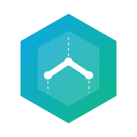

<a href="https://github.com/rrushikeshp89">
  <picture>
    <source media="(prefers-color-scheme: dark)" srcset="assets/header-dark.svg">
    
  </picture>
</a>

  <a href="#selected-work">Selected work</a> &nbsp;·&nbsp;
  <a href="#explainable-ai-and-data-science">AI and data science</a> &nbsp;·&nbsp;
  <a href="#how-i-work">How I work</a> &nbsp;·&nbsp;
  <a href="#toolbox">Toolbox</a> &nbsp;·&nbsp;
  <a href="#get-in-touch">Get in touch</a>

 

I came to software through data science, and I still think like an analyst: **if a system gives you a number, it should be able to tell you why.** That idea runs through everything here. A clinical model gives a reason with every risk score, a résumé matcher shows its arithmetic, and a CRM labels its estimates as estimates.

Lately I build complete business systems (HR, inventory, sales) end to end: the data model, permissions enforced on the server, an accessible interface, the tests and the deployment. Each one ships with a live demo and an honest list of what it doesn't do yet.

 

<table align="center">
  <tr>
    <td align="center" width="170"><h3>6</h3>public projects</td>
    <td align="center" width="170"><h3>4</h3>live demos</td>
    <td align="center" width="170"><h3>830+</h3>automated tests</td>
    <td align="center" width="170"><h3>100</h3>Lighthouse accessibility score on Grove</td>
  </tr>
</table>

 

## Selected work

###  Grove &nbsp;HRMS · flagship

**An HR system people actually enjoy using.** People, attendance, leave, payroll, hiring, performance and analytics for a company of about 100, with separate experiences for employees, managers, HR and admins.

- **45 tables, 23 feature modules, 4 roles** with scoped, record-level permissions
- **One door for every change:** sign-in check, Zod validation and permission check, then the change, its audit entries and its notifications commit in one transaction, or none of them do
- **A four-eyes rule on payroll:** whoever prepares a pay run can't finalize it
- **369 unit and 420 end-to-end tests**, 0 serious axe violations, keyboard shortcuts for everything, light and dark themes checked against WCAG AA by a test

`Next.js 16` `React 19` `TypeScript` `Prisma 7` `PostgreSQL` `Supabase` `Better Auth` `Tailwind 4` `Radix` `Playwright`

[**Open the live demo →**](https://grove-hrms.vercel.app) &nbsp;·&nbsp; [Source](https://github.com/rrushikeshp89/grove-hrms) &nbsp;·&nbsp; [Design system](https://grove-hrms.vercel.app/design)

 

<table>
  <tr>
    <td width="50%" valign="top">
      
      <h3> Stockroom ERP</h3>
      
<b>Inventory and purchase orders for small shops and cafés.</b> It knows what's in the back room and suggests what to reorder before it runs out.

      <ul>
        <li>Stock changes <b>only when goods arrive</b>, in one all-or-nothing transaction. Database triggers block direct edits and negative stock</li>
        <li>Access control in four layers: route permissions, row scope, per-record rules with separation of duties, and field masking</li>
        <li>Layout shift ≤ 0.004, no sideways scrolling from 360 to 1920 px, full flow works keyboard-only, measured in 175 audit runs</li>
      </ul>
      <code>React 18</code> <code>TypeScript</code> <code>Express 5</code> <code>SQLite</code> <code>Zod</code> <code>JWT</code>
      
<a href="https://stockroom-erp.onrender.com"><b>Live demo →</b></a> &nbsp;·&nbsp; <a href="https://github.com/rrushikeshp89/stockroom-erp">Source</a>

    </td>
    <td width="50%" valign="top">
      
      <h3> LeadHub CRM</h3>
      
<b>A sales CRM for teams selling software, AI and consulting.</b> Leads, a 10-stage pipeline, proposals and follow-ups in one place.

      <ul>
        <li>Weighted forecasts, and only Closed Won counts as revenue. A lost deal always needs a reason</li>
        <li>A public inquiry form becomes a lead and a follow-up task, assigned to the least-busy rep</li>
        <li>Optional Claude assistant for summaries, next steps and email drafts. It suggests and never changes data on its own</li>
        <li>37 tests, including 12 simultaneous writes. The Docker image is tested in CI and <code>npm audit</code> reports 0 vulnerabilities</li>
      </ul>
      <code>React 18</code> <code>TypeScript</code> <code>Express 5</code> <code>libSQL / Turso</code> <code>Docker</code> <code>Claude API</code>
      
<a href="https://leadhub-9stj.onrender.com/inquiry"><b>Try the inquiry form →</b></a> &nbsp;·&nbsp; <a href="https://github.com/rrushikeshp89/leadhub-crm">Source</a>

    </td>
  </tr>
</table>

 

## Explainable AI and data science

<table>
  <tr>
    <td width="33%" valign="top">
      <h3> Tessaract</h3>
      
<b>Résumé-to-job matching that shows its work.</b>

      
Every fit score breaks down into four weighted parts, with matched and missing skills, a gap report and a blind mode that hides identity. Core scoring needs no LLM API.

      <pre>fit = 0.40 × semantic
    + 0.35 × skills
    + 0.15 × experience
    + 0.10 × education</pre>
      <code>FastAPI</code> <code>Sentence-Transformers</code> <code>PostgreSQL</code> <code>Redis</code> <code>React 19</code> <code>Docker</code>
      
<a href="https://github.com/rrushikeshp89/Tessaract">Source →</a>

    </td>
    <td width="33%" valign="top">
      <h3> StrategyRoom.ai</h3>
      
<b>Investment research by two cooperating agents.</b>

      
A researcher agent gathers live sources with Firecrawl, and an analyst agent built on Gemini 2.5 Flash returns Buy, Hold or Sell with a confidence breakdown, its reasoning and citations. It adds watchlists, alerts, sector scans and scheduled re-research.

      <code>React</code> <code>TypeScript</code> <code>Supabase Edge Functions</code> <code>Postgres RLS</code> <code>Gemini</code> <code>Firecrawl</code>
      
<a href="https://github.com/rrushikeshp89/StrategyRoom.ai">Source →</a>

    </td>
    <td width="33%" valign="top">
      <h3>🛡️ Readmission Shield</h3>
      
<b>An early warning for 30-day hospital readmission.</b>

      
The model flags diabetic patients at risk before discharge. On a 9:91 class imbalance, XGBoost with class weighting reaches <b>0.55 recall</b> and <b>0.65 AUC</b>. SHAP gives clinicians a reason for every score, and a QA gatekeeper checks for data leakage before release.

      <code>Python</code> <code>XGBoost</code> <code>SHAP</code> <code>pandas</code> <code>Streamlit</code>
      
<a href="https://hospital-readmission-shield-diabetes-mxh3cfy4tg5movmukaphtm.streamlit.app/"><b>Live app →</b></a> &nbsp;·&nbsp; <a href="https://github.com/rrushikeshp89/Hospital-Readmission-Shield-Diabetes">Source</a>

    </td>
  </tr>
</table>

 

## How I work

<table>
  <tr>
    <td width="33%" valign="top">
      <b>Show the why</b>  
      A score comes with its breakdown and a verdict comes with its sources. An estimate is labelled as one. People trust what they can check.
    </td>
    <td width="33%" valign="top">
      <b>Enforce it on the server</b>  
      Permissions, state machines and money rules live on the server and in database constraints, never only in the UI. The browser hides buttons, and the server decides.
    </td>
    <td width="33%" valign="top">
      <b>Prove it, then say what's missing</b>  
      Tests for business rules, browser tests for flows, accessibility scans in both themes. Every README says plainly what isn't built yet.
    </td>
  </tr>
</table>

 

## Toolbox

  

| Area | Tools |
| --- | --- |
| **Languages** | TypeScript, Python, SQL |
| **Front end** | React 18 and 19, Next.js 16 (Server Components and Actions), Tailwind, Radix, Motion, Recharts, TanStack Table |
| **Back end and data** | Node.js, Express 5, FastAPI, PostgreSQL, SQLite and libSQL, Redis, Prisma, Supabase (Auth, Edge Functions, RLS) |
| **AI and ML** | Claude API, Gemini, Sentence-Transformers, XGBoost, SHAP, scikit-learn, pandas, multi-agent orchestration |
| **Quality** | Vitest, Playwright, axe-core, Lighthouse, WCAG 2.1 AA, node:test, pytest |
| **Delivery** | Docker, GitHub Actions, Vercel, Render, Streamlit Cloud, Dependabot |

 

## Along the way

| When | What I built | Focus |
| --- | --- | --- |
| Nov 2026 | [**Grove**](https://github.com/rrushikeshp89/grove-hrms) HRMS | My own design system, a full HR suite, and 789 tests behind it |
| Oct 2026 | [**Stockroom**](https://github.com/rrushikeshp89/stockroom-erp) ERP · [**LeadHub**](https://github.com/rrushikeshp89/leadhub-crm) CRM | Integrity enforced by the database itself, and a CRM in use by a real team |
| Mar 2026 | [**Tessaract**](https://github.com/rrushikeshp89/Tessaract) · [**StrategyRoom.ai**](https://github.com/rrushikeshp89/StrategyRoom.ai) | Explainable scoring and multi-agent AI that people can audit |
| Dec 2025 | [**Readmission Shield**](https://github.com/rrushikeshp89/Hospital-Readmission-Shield-Diabetes) | Clinical machine learning on imbalanced data, explained with SHAP |

 

## Get in touch

  
  
  

If something here is useful to you, or you'd like to talk about building something similar, I'd be glad to hear from you.

 

Every company, person and figure in the screenshots is fictional demo data.

