<a href="https://rrushikeshp89.github.io/motionfolio/">
  <picture>
    <source media="(prefers-color-scheme: dark)" srcset="assets/header-dark.svg">
    
  </picture>
</a>

  <a href="https://rrushikeshp89.github.io/motionfolio/"><picture><source media="(prefers-color-scheme: dark)" srcset="assets/btn-motionfolio-dark.svg"></picture></a> <a href="https://rrushikeshp89.github.io"><picture><source media="(prefers-color-scheme: dark)" srcset="assets/btn-portfolio-dark.svg"></picture></a> <a href="https://rrushikeshp89.github.io/resume.pdf"><picture><source media="(prefers-color-scheme: dark)" srcset="assets/btn-resume-dark.svg"></picture></a>
   
  <a href="https://www.linkedin.com/in/rushikesh-panchal/"><picture><source media="(prefers-color-scheme: dark)" srcset="assets/btn-linkedin-dark.svg"></picture></a> <a href="https://mail.google.com/mail/?view=cm&amp;fs=1&amp;to=rrushikeshp8%40gmail.com"><picture><source media="(prefers-color-scheme: dark)" srcset="assets/btn-email-dark.svg"></picture></a> <a href="https://orcid.org/0009-0001-8991-1702"><picture><source media="(prefers-color-scheme: dark)" srcset="assets/btn-orcid-dark.svg"></picture></a>

 

I came to software through data science, and I still think like an analyst: **if a system gives you a number, it should be able to tell you why.** Today I build complete business systems end to end, from the data model and server-side permissions to an accessible interface, the tests and the deployment. Every project ships with a live demo and an honest list of what it doesn't do yet.

> [!TIP]
> **New:** [Motionfolio](https://rrushikeshp89.github.io/motionfolio/) is my animated portfolio. Hover the letters of my name, switch roles in the live RBAC simulator, and watch Grove's write path trace itself.

 

<picture>
  <source media="(prefers-color-scheme: dark)" srcset="assets/stats-dark.svg">
  
</picture>

 

## Portfolios

<a href="https://rrushikeshp89.github.io/motionfolio/">
  <picture>
    <source media="(prefers-color-scheme: dark)" srcset="assets/motionfolio-dark.svg">
    
  </picture>
</a>

  
    <a href="https://rrushikeshp89.github.io/motionfolio/"><b>Motionfolio</b></a> (<a href="https://github.com/rrushikeshp89/motionfolio">source</a>) &nbsp;·&nbsp;
    <a href="https://rrushikeshp89.github.io"><b>Main portfolio</b></a> with case studies and résumé (<a href="https://github.com/rrushikeshp89/rrushikeshp89.github.io">source</a>)
  

 

## Selected work

<a href="https://github.com/rrushikeshp89/grove-hrms">
  <picture>
    <source media="(prefers-color-scheme: dark)" srcset="assets/grove-dark.svg">
    
  </picture>
</a>

<a href="https://github.com/rrushikeshp89/stockroom-erp"><picture><source media="(prefers-color-scheme: dark)" srcset="assets/stockroom-dark.svg"></picture></a>&nbsp;<a href="https://github.com/rrushikeshp89/leadhub-crm"><picture><source media="(prefers-color-scheme: dark)" srcset="assets/leadhub-dark.svg"></picture></a>

 

## Explainable AI and data science

<a href="https://github.com/rrushikeshp89/Tessaract"><picture><source media="(prefers-color-scheme: dark)" srcset="assets/tessaract-dark.svg"></picture></a>&nbsp;<a href="https://github.com/rrushikeshp89/StrategyRoom.ai"><picture><source media="(prefers-color-scheme: dark)" srcset="assets/strategyroom-dark.svg"></picture></a>&nbsp;<a href="https://hospital-readmission-shield-diabetes-mxh3cfy4tg5movmukaphtm.streamlit.app/"><picture><source media="(prefers-color-scheme: dark)" srcset="assets/readmission-dark.svg"></picture></a>

<b>Every project at a glance</b> (links, stack and status)

 

| Project | What it is | Built with | Try it |
| --- | --- | --- | --- |
| **[Motionfolio](https://github.com/rrushikeshp89/motionfolio)** | Animated portfolio: kinetic type, RBAC simulator, self-tracing write path. Lighthouse 100 ×4, 147.2 kB JS, 113 tests | Next.js 16, React 19, Tailwind v4, Web Animations API, Playwright + axe | [Live](https://rrushikeshp89.github.io/motionfolio/) |
| **[Portfolio](https://github.com/rrushikeshp89/rrushikeshp89.github.io)** | Main portfolio with case studies and résumé. Zod-validated content | Next.js (static), strict TypeScript, Playwright, axe | [Live](https://rrushikeshp89.github.io) |
| **[Grove HRMS](https://github.com/rrushikeshp89/grove-hrms)** | HR system: people, attendance, leave, payroll, hiring. 45 tables, 28 scoped permissions, 4 roles, 130+ tests | Next.js 16, TypeScript, Prisma, Supabase Postgres, Better Auth, Playwright | [Live demo](https://hrms.fluentopsai.com) |
| **[Stockroom](https://github.com/rrushikeshp89/stockroom-erp)** | Inventory and purchase-order ERP. Atomic receiving, append-only stock history, 4-layer RBAC | React, TypeScript, Express 5, SQLite, Zod | [Live demo](https://erp.fluentopsai.com) |
| **[LeadHub](https://github.com/rrushikeshp89/leadhub-crm)** | B2B sales CRM. One shared TypeScript domain layer, weighted pipeline, Claude assistant | React, Express 5, Turso (libSQL), Docker, Claude API | [Inquiry form](https://crm.fluentopsai.com/inquiry) |
| **[Tessaract](https://github.com/rrushikeshp89/Tessaract)** | Explainable résumé-to-job matching with deterministic weighted scoring | FastAPI, Sentence-Transformers, Postgres, React 19 | Source |
| **[StrategyRoom.ai](https://github.com/rrushikeshp89/StrategyRoom.ai)** | Two-agent investment research with a reasoning chain and citations | Supabase, Gemini, React | Source |
| **[Readmission Shield](https://github.com/rrushikeshp89/Hospital-Readmission-Shield-Diabetes)** | 30-day readmission risk for diabetic patients, with SHAP reasons for every score | Python, XGBoost, SHAP, Streamlit | [Live demo](https://hospital-readmission-shield-diabetes-mxh3cfy4tg5movmukaphtm.streamlit.app/) |

The LeadHub CRM holds a real team's data, so sign-in is by invitation; the public inquiry form is open to try.

 

## How I work

<picture>
  <source media="(prefers-color-scheme: dark)" srcset="assets/principles-dark.svg">
  
</picture>

 

## Experience and education

<picture>
  <source media="(prefers-color-scheme: dark)" srcset="assets/experience-dark.svg">
  
</picture>

 

## Stack

<picture>
  <source media="(prefers-color-scheme: dark)" srcset="assets/icons-dark.svg">
  
</picture>

 

<a href="https://mail.google.com/mail/?view=cm&amp;fs=1&amp;to=rrushikeshp8%40gmail.com">
  <picture>
    <source media="(prefers-color-scheme: dark)" srcset="assets/contact-dark.svg">
    
  </picture>
</a>

  <b>Click the card to email me in Gmail</b>, or use your own mail app: <a href="mailto:rrushikeshp8@gmail.com"><b>rrushikeshp8@gmail.com</b></a>

Every company, person and figure in the project screenshots is fictional demo data. The cards above are generated by <a href="scripts/build_cards.py"><code>scripts/build_cards.py</code></a>.

